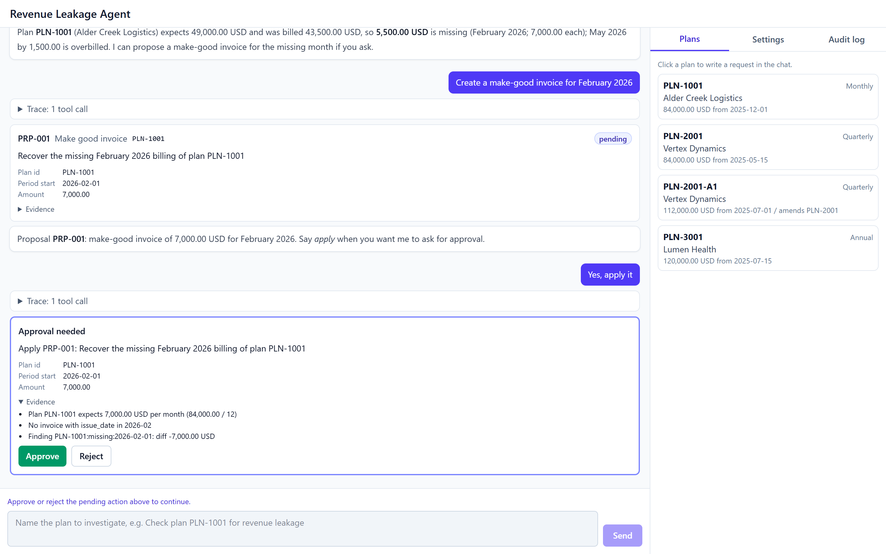

# Revenue Leakage Agent

[](https://github.com/theviderlab/revenue-leakage-agent/actions/workflows/ci.yml)
[](LICENSE)

A chat agent that finds revenue a company should have billed but did not, explains why, and fixes it only after a human approves each correction.



## The problem

Subscription contracts say what should be billed and when: 84,000 USD a year, invoiced monthly, from December 1. Billing systems drift from that. A month gets skipped, an invoice goes out in the wrong currency, a contract is amended mid-quarter and nobody updates the schedule, a credit memo cancels half of an invoice. The difference between what the contracts promise and what was invoiced is revenue leakage. Finding it means reconciling every plan against every invoice, period by period, and the data rarely answers every question on its own: when does a quarter start, how is an amendment prorated, is data after the last export missing or just not loaded yet?

An LLM is good at explaining that kind of analysis and bad at doing the arithmetic reliably. An agent that writes invoices also needs a hard stop before anything touches the books. This project splits the work that way: a deterministic detector computes, the LLM explains and proposes, and a person approves every write.

## What it does

- **Detects.** For each billing plan, a deterministic detector (no LLM) lists every expected period as `ok`, `missing`, `underbilled`, `overbilled`, `pending_decision` or `no_data`, with expected and billed totals net of credit memos, in the plan's currency. Each plan gets a confidence level, and records that cannot be placed (an invoice with no plan, an invoice with no exchange rate) go to an explicit residue instead of being guessed.
- **Explains.** The LLM reads the findings, explains them in plain language and labels hypotheses as hypotheses. It never computes amounts.
- **Proposes.** On request, it drafts a make-good invoice (recover a missed or underbilled period), a credit memo (reduce an overbilled invoice), a plan amendment, or links or dismisses an invoice that has no plan. Each proposal is validated against the detector before it is shown.
- **Waits for approval.** Every write and every rollback stops at an approval card in the chat. Nothing is written until the user clicks Approve; a "yes" typed in the chat is not an approval.
- **Applies to a sandbox.** Approved actions go to append-only ledgers plus an audit log under `STATE_DIR`. The input data in `data/` is never modified, and rolling back marks an action as reverted instead of deleting it. Re-running the check after a correction shows the period resolved.
- **Keeps assumptions explicit.** What the data does not decide (the analysis cutoff, whether data is up to date, the period calendar, amendment proration, auto-renewal) lives in a settings panel that only the user can change. When the alternatives give different results for a plan, its findings drop to `low` confidence and admit no proposals until the user picks one.

## Run it

Prerequisites: [uv](https://docs.astral.sh/uv/) (Python 3.12), Node.js and GNU make.

Without an API key, run the scripted mock backend. It serves a fixed conversation about plan `PLN-1001` with the same API and cards as the real agent, and ignores the analysis settings:

```
make install
make dev AGENT_BACKEND=mock
```

With an LLM (any OpenAI-compatible endpoint; developed with `anthropic/claude-sonnet-5.5` through OpenRouter):

```
make install
cp .env.example .env   # then set LLM_API_KEY
make dev               # API on :8000, SPA on :5173, with hot reload
```

Open http://localhost:5173. A first conversation: set `as_of` to 2026-06-30 in the Settings tab, ask `Check all plans for revenue leakage.`, then `Propose a make-good for February 2026 on PLN-1001`, and approve the card. `make reset` (with the app stopped) clears the sandbox and the conversations.

Other targets: `make check` (lint, type check and tests), `make test`, `make lint`, `make format`, `make types` (regenerate the frontend API types from the OpenAPI schema), `make smoke-llm` and `make eval-llm` (against the real LLM), `make clean`.

Configuration lives in the root `.env`: `LLM_MODEL`, `LLM_BASE_URL`, `LLM_API_KEY`, `AGENT_BACKEND` (`real` or `mock`), `STATE_DIR` (default `.state/`) and `DATA_DIR` (default `data/`). `GET /api/health` reports which backend is running.

## Architecture

```
backend/   FastAPI (uv, Python 3.12)
  app/domain/     detector, periods, fx, sandbox (ledgers, overlay), actions (propose / apply / rollback)
  app/agent/      LangGraph graph, tools, system prompt, events, real service
  app/mock.py     scripted service with the same contract
  app/schemas.py  API contract (Pydantic)
frontend/  React + Vite + TypeScript + Tailwind v4: chat with cards, side panel with plans, settings and audit log
data/      read-only input: billing plans, invoices, credit memos, exchange rates
docs/      design decisions, API contract, data analysis, agent know-how
```

- **Graph.** Three nodes and no intent router: `agent` (the LLM with tools), `tools` (runs them in order) and `human_review`, which calls LangGraph's `interrupt()` before every apply and rollback. Graph state (active plan, findings, proposals, reviews) is written only by tools, never parsed from the LLM's text. The checkpointer is SQLite under `STATE_DIR`, so a pending approval survives a server restart.
- **Detector first.** The LLM calls the detector as a tool and gets structured findings back. Proposals are checked against the same findings, so the agent cannot propose a make-good for a period that is not missing, or a credit memo on a `low` confidence plan.
- **Typed events.** `POST /api/threads/{id}/messages` and `/decisions` return `{events, state}`, with events such as `tool_call`, `findings`, `proposal` and `approval_request`. The frontend renders cards from events and never parses LangChain messages. Totals and statuses always come from the API; the client does not recompute them.
- **Sandbox overlay.** Reads see `data/` plus the active sandbox records, marked `source: "sandbox"`.
- **Domain knowledge.** Key concepts and rules live in `backend/app/knowledge.md` and are retrieved by key (no embeddings).

The full contract is in [docs/api.md](docs/api.md) and every design decision, with its rejected alternatives, in [docs/design.md](docs/design.md).

## Data and assumptions

The dataset in `data/` is synthetic: 4 plans for 3 customers, with monthly, quarterly and annual billing, an amendment that replaces a plan mid-quarter, invoices in USD and EUR, a credit memo, an unpaid invoice and an invoice with no plan. Data ends on 2026-06-30. The analysis of what it contains and the ambiguities it leaves open is in [docs/data-analysis.md](docs/data-analysis.md).

Fixed rules (decisions D19 to D22 in [docs/design.md](docs/design.md)):

- Billing is in advance: each invoice belongs to the period that contains its issue date.
- Every plan lasts 12 months from `start_date`. The amount per period is `total_value` divided by the periods in 12 months; partial periods are prorated by whole months when possible, by days otherwise.
- Amounts are converted with the exchange rate of the invoice date, only in the published direction; an invoice without a rate goes to the residue. Credit memos are subtracted from their invoice. Unpaid invoices count as billed and are flagged.
- Periods after the end of the data are `no_data`, not `missing`, unless the user states in the panel that the data is up to date. The agent asks once.
- An invoice with no plan is never assigned automatically. It is a pending decision (link or dismiss) that blocks proposals on the periods it could explain.
- Entitlements are not verified: the data has no price per entitlement, and the agent says so.

The expected detector results for the base case (291,728.26 expected, 227,500.00 net, -64,228.26 gap) and for each settings variant are tabulated in `docs/design.md`, and the tests check the detector against that table.

## Known limitations

- The LLM sometimes answers in Spanish to an English prompt, or quotes an internal finding key. An imperative request ("Issue a credit memo ...") proposes and applies in the same turn. Both still stop at the approval card: nothing is written without approval.
- Error events are kept in memory, so reloading the page after a server restart does not show them.
- Configuration and error paths have less test coverage than the detector and the approval flow.
- The sandbox is a set of local JSON ledgers, not an integration with a billing system.

## License

[MIT](LICENSE)
